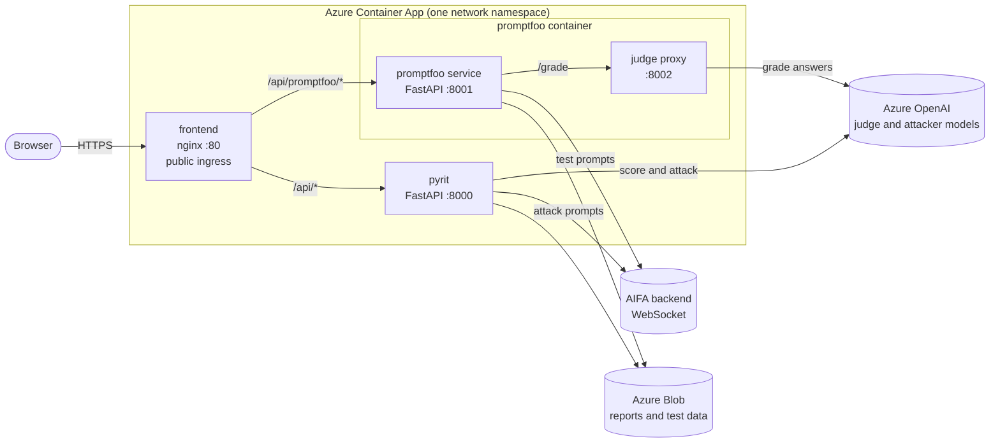
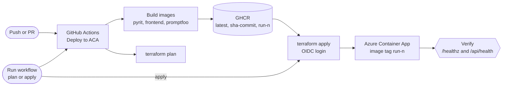

# AI evaluation workspace

Red-team and quality evaluation for the **AI Form Assist (AIFA)** water-licence assistant. It sends test prompts to the hosted AIFA WebSocket API and scores the answers.

| Product | What it does | Docs |
|---|---|---|
| **PyRIT** (`aifa_pyrit/`) | Adversarial attacks (jailbreaks, prompt injection, multi-turn) with scoring; CLI + FastAPI | [aifa_pyrit/README.md](aifa_pyrit/README.md) |
| **Promptfoo** (`promptfoo/`) | Quality eval of curated test cases, graded by a judge model | [promptfoo/README.md](promptfoo/README.md) |
| **Frontend** (`frontend/`) | Browser UI for both (static files behind nginx) | [frontend/README.md](frontend/README.md) |
| **Infra** (`infra/aca/`, `.github/workflows/`) | Terraform + GitHub Actions release to Azure Container Apps | [infra/README.md](infra/README.md) |



Other folders: `data/` (PyRIT test cases), `data_promptfoo/` (Promptfoo test cases), `results/` and `results-promptfoo/` (reports), `docs/` (proxy and registry notes), [env-inventory.md](env-inventory.md) (every environment variable per container).

## Prerequisites

Python 3.11+, [uv](https://docs.astral.sh/uv/), Node.js 22+, Docker (for Compose), and for releases the Azure CLI and GitHub CLI.

## 1. Configure

```bash
uv sync --extra dev
cp aifa_pyrit/.env.example aifa_pyrit/.env      # PyRIT settings
cp promptfoo/.env.example promptfoo/.env        # Promptfoo settings
```

Fill in the AIFA backend URL (`BACKEND_API_URL`, a `wss://…/ws` endpoint), the judge model (`AUDIT_LLM_*`) and, for LLM attacks, `ADVERSARIAL_OPENAI_*`. Never commit `.env` files.

## 2. Run locally (CLI)

Each product also runs on its own; see its README for details.

```bash
# PyRIT command line
uv run red-team list-cases
uv run red-team scan --use-file -a PromptSending

# Browser UI + PyRIT API on http://localhost:8011
uv run python -m uvicorn aifa_pyrit.web_app:app --port 8011
```

The Promptfoo pages of the UI also need the promptfoo service (the UI on `:8011` forwards `/api/promptfoo/*` to `:8001`):

```bash
cd promptfoo && uv sync && npm ci && cd ..
(cd promptfoo && set -a && . ./.env && set +a && node azure-grader-proxy.js) &   # judge proxy :8002
promptfoo/.venv/bin/python -m uvicorn promptfoo.src.promptfoo_service:app --port 8001
```

## 3. Run with Docker Compose

Mirrors production: only the frontend is exposed.

```bash
docker compose up --build        # UI at http://localhost:8080
docker compose logs -f promptfoo # follow one service
docker compose down
```

The PyRIT API is also published on `http://localhost:8011` for debugging. Compose reads `aifa_pyrit/.env` and `promptfoo/.env`; set `PROMPTFOO_RUN_TOKEN` in your shell to require a token on Promptfoo calls. Reports persist in `results/` and `results-promptfoo/`.

## 4. Production release (Azure Container Apps)

One Container App runs the three containers; only the frontend has public ingress. Details and variables: [infra/README.md](infra/README.md).



**One-time setup:** run [initial-azure-setup.sh](initial-azure-setup.sh) to create the GitHub OIDC identity and Terraform state storage, add the identity to the Azure contributor group, then set the secrets and variables in the GitHub `dev` environment.

**Release:**

1. Push your branch or open a PR. *Deploy to ACA* builds the three images, pushes them to GHCR (`latest`, `sha-<commit>`, `run-<n>`) and runs `terraform plan`.
2. GitHub → Actions → **Deploy to ACA** → Run workflow → `plan`, review, then run again with `apply`.
3. Verify using the `container_app_url` output: `/healthz`, `/api/health`, `/api/promptfoo/info`.

**Rollback:** re-run the `apply` workflow run of the last good release; it redeploys that run's image tag.

## Troubleshooting

- **404 on `/api/promptfoo/*` locally:** the promptfoo service on `:8001` is not running or is stale; restart it.
- **UI shows old behavior:** hard-reload (`Cmd/Ctrl+Shift+R`); the browser caches scripts.
- **Judge returns 404:** `AUDIT_LLM_ENDPOINT` must serve `/openai/deployments/<deployment>/chat/completions`. Check with `promptfoo/test_grader_no_proxy.sh`.
- **Azure calls hang locally:** unset `HTTP_PROXY`, `HTTPS_PROXY`, `ALL_PROXY` unless you need the tunnel ([docs/proxy-connection-guide.md](docs/proxy-connection-guide.md)).
- **Where did my reports go:** `results/` (PyRIT) and `results-promptfoo/` locally; Blob containers when `AZURE_STORAGE_CONNECTION_STRING` is set.
